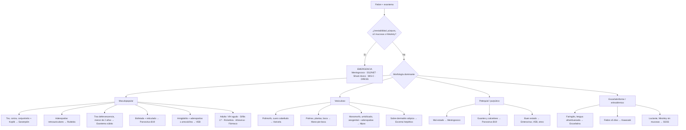

# Virus cutáneos, parásitos y exantemas

> [!info] Ordenación editorial
> Se conserva íntegro el contenido del curso y de la ampliación. Este índice no revalida dosis, cifras, calendario ni afirmaciones clínicas; siguen vigentes las advertencias y los bloques SIN CONTRASTAR del documento.

## Índice

- [[#🔴 Herpesvirus|Herpesvirus del curso]]
- [[#🟣 Poxvirus|Poxvirus]]
- [[#🟤 Papilomavirus (VPH)|VPH]]
- [[#🪲 Parásitos|Parásitos]]
- [[#🔴 Exantemas víricos|Revisión de exantemas víricos]]
- [[#⚡ Perlas de guardia|Perlas de guardia]]
- [[#🧭 Enfoque sindrómico|Enfoque sindrómico]]
- [[#📊 Cuadro comparativo|Cuadro comparativo]]
- [[#1️⃣ Sarampión|Sarampión]]
- [[#2️⃣ Rubéola|Rubéola]]
- [[#3️⃣ Eritema infeccioso (5.ª enfermedad) — Parvovirus B19|Parvovirus B19]]
- [[#4️⃣ Exantema súbito (roséola, 6.ª enfermedad) — VHH-6B y VHH-7|Exantema súbito]]
- [[#5️⃣ Varicela — VVZ|Varicela]]
- [[#6️⃣ Enfermedad mano-pie-boca — Enterovirus|Mano-pie-boca]]
- [[#7️⃣ VEB y exantemas paravirales|VEB y cuadros paravirales]]
- [[#8️⃣ Mpox (diferencial del exantema vesiculoso)|Mpox]]
- [[#🚨 Diferencial no vírico que no puede escaparse|Diferencial no vírico]]
- [[#🤰 Embarazada expuesta a exantema|Embarazo]]
- [[#🏫 Exclusión escolar y laboral (orientativa)|Exclusión escolar y laboral]]
- [[#💉 Calendario vacunal 2026 (lo relevante para exantemas)|Calendario vacunal]]
- [[#❓ Zonas de incertidumbre|Incertidumbre]]
- [[#🔗 Notas relacionadas|Notas relacionadas]]
- [[#📚 Fuentes|Fuentes]]

[[Dermatología pediátrica|Dermatología pediátrica]] · [[MOC - DERMATOLOGIA]]

> [!info] Leyenda
> Las viñetas con ➕ no son del curso: completan huecos con la fuente entre paréntesis. ⚠️ = discrepancia con lo apuntado en el curso.
> 🧪 El bloque **morado** al final de los apuntes del curso son propuestas de Claude **sin contrastar**.

## 🔴 Herpesvirus

### VHS
- **Lesión:** vesículas.
- **Tto:** si muy sintomático → **valaciclovir 2 g/12 h × 1 día**; comprobar función renal.
	- ➕ Es la pauta del herpes labial recurrente; para la primoinfección y el herpes genital, ver [[ITS e infecciones víricas cutáneas|ITS]] (CIMA)
- **Genital:** cuidado con las **úlceras dolorosas**; no siempre acuden en fase de vesícula.
- ***Eccema herpeticum*:** complicación propia de los pacientes con **dermatitis atópica**.
	- ➕ Antiviral sistémico **inmediato**, sin esperar a la PCR: aciclovir 400-800 mg 5 veces/día o valaciclovir 1 g/12 h × 10-14 días o hasta que curen las lesiones; **IV** si está grave, es inmunodeprimido o no tolera la VO (DermNet)
	- ➕ Suspender corticoides potentes y tacrolimus tópicos; ATB antiestafilocócico si hay sobreinfección (DermNet)
	- ➕ Afectación palpebral u ocular → Oftalmología (DermNet); valoración especializada el mismo día (NICE QS44)

### VVZ — herpes zóster
- Suelen acudir a Urgencias **por dolor**.
- **Distribución** por dermatomas, **unilateral**; en la fase inicial, solo eritema.
- **Tto:** **valaciclovir 1 g/8 h × 7 días**; más efectivo en las **primeras 72 h**.
	- ➕ Alternativas: aciclovir 800 mg 5 veces/día × 7 días; brivudina 125 mg/24 h × 7 días (contraindicada en inmunodeprimidos y si ha recibido 5-FU en las 4 semanas previas) (Herpes Zóster)
- **Cuidado con:** síndrome de **Ramsay Hunt** y afectación **oftalmológica**.
	- ➕ Zóster oftálmico: lesiones en la punta o el lateral de la nariz (**signo de Hutchinson**) → más complicaciones; derivar a Oftalmología. Ramsay Hunt → ORL (Herpes Zóster)
- **Criterios de ingreso:** infección diseminada o afectación visceral → **aciclovir IV 10 mg/kg/8 h**.

### Varicela
- Lesiones en **"cielo estrellado"**, en distintos estadios de evolución (progresión cefalocaudal).
- **Pruebas:**
	- Rx y AS si clínica respiratoria o inmunodeprimidos.
	- PCR de virus en piel.
- **Sintomático:** **no usar AINE** ni AAS.
- **Tto:** **valaciclovir 1 g/8 h × 5 días**.
- **Diseminada o grave:** **aciclovir IV 30 mg/kg/día (= 10 mg/kg/8 h)**.

## 🟣 Poxvirus

### Molluscum contagiosum
- En adultos → **ITS**.
	- ➕ Anogenital en adulto: tratar para reducir el contagio, evitar el curetaje genital y ofrecer cribado de ITS (Derma 16)
- **Tto:**
	- Crioterapia / curetaje.
	- Molusk® / Molutrex®.
		- ➕ = hidróxido potásico tópico (Molutrex® al 5 %), de aplicación domiciliaria (Acta Pediatr Esp)
	- Otras opciones.
		- ➕ Podofilotoxina (adultos, anogenital), cantaridina aplicada en consulta (≥2 años), ácido tricloroacético (MSD; Recop. Derma 2025)
	- Actitud expectante: resolución en **2-24 meses**.
- **DDx:** varicela, mpox.

## 🟤 Papilomavirus (VPH)

### Verrugas
- Verruga **periungueal** → derivar a Dermatología.
- ➕ 1.ª línea: **ácido salicílico** tópico (15-40 %) con limado previo; alternativa: **crioterapia**, más eficaz en la verruga común pero más dolorosa (PREEVID; GPC británica)
- ➕ La regresión espontánea es frecuente (60-70 %) (AEPap)

### Condilomas acuminados
- **DDx:** condilomas planos de la **sífilis secundaria**.
- **Tto:** **imiquimod** 2-3 veces/semana, **máximo 16 semanas**.

## 🪲 Parásitos

### Sarna
- No siempre se ven los surcos fácilmente → fijarse en:
	- **Prurito nocturno**.
	- Epidemiología.
	- Tratamientos tópicos previos.
- **Tto:**
	- **Permetrina 5 %**: aplicar del cuello hacia abajo; repetir en 1 semana; **todos a la vez**.
		- ➕ Dejar actuar 8-14 h y lavar; SEIMC 2026 repite a los 7-14 días (Sarna - Escabiosis)
	- **Ivermectina 200 µg/kg** VO en dosis única; repetir a la semana.
		- ➕ En ayunas (nada 2 h antes ni 2 h después); seguridad no establecida si <15 kg (CIMA)
	- Lavar la ropa a **50 ºC** o guardarla en una bolsa 24 h.
		- ➕ ⚠️ La nota del vault recomienda lavar a **≥60 ºC** o aislar en bolsa sellada **1 semana** ([[Sarna - Escabiosis]])

> [!warning] Sarna noruega
> **Ivermectina 200 µg/kg** durante un tiempo variable + **queratolíticos**.
> ➕ SEIMC 2026: permetrina 5 % diaria × 7 días, luego 2-3 veces/semana × 2 semanas + ivermectina 200 µg/kg los días **1, 2 y 8**; manejo por Dermatología/Infecciosas con aislamiento de contacto (Sarna - Escabiosis)

### Leishmaniosis cutánea
- ➕ **Agente en España:** *Leishmania infantum*; endémica en casi todo el territorio e infradeclarada (Rev Pediatr Aten Primaria 2010)
- ➕ **Clínica:** pápula o nódulo indoloro en zona expuesta (la cara en niños) que crece despacio durante meses y puede descamar, costrar o ulcerarse («botón de Oriente»). Pensar en ella ante una lesión tórpida que no responde a ATB (casos españoles, Semergen)
- ➕ **Dx:** biopsia en *punch* (histología y Giemsa: amastigotes) + **PCR** de *Leishmania* (casos españoles, Rev Clin Esp)
- ➕ **Tto:** tiende a curar sola, pero deja cicatriz. 1.ª línea en España: **antimoniato de meglumina intralesional** (Glucantime®) ± crioterapia (Rev Pediatr Aten Primaria 2010)
	- ➕ Sistémico si hay lesiones múltiples o grandes (>4-5 cm), en la cara o cerca de articulaciones, persistentes >6 meses, con riesgo de afectación mucosa o refractarias (Rev Pediatr Aten Primaria 2010; Actas Dermosifiliogr)

### Piojos (pediculosis)
- **Permetrina 5 %**; recomiendan corticoide tópico entre aplicaciones; repetir en 1 semana.
	- ➕ ⚠️ En la pediculosis las guías usan **permetrina 1-1,5 %** o **dimeticona 4 %**; la permetrina al 5 % con corticoide entre aplicaciones es la pauta de la **sarna**: comprueba si esta línea iba en Sarna (Guía ABE)
- ➕ Pauta: **dimeticona 4 %** o **permetrina 1-1,5 %** (>2 años); repetir a los **7-10 días** + lendrera. De 6 meses a 2 años: dimeticona; <6 meses: solo retirada mecánica (Guía ABE)
- ➕ El tiempo de aplicación varía según el producto: seguir el prospecto (Guía ABE)

---

> [!example]+ 🧪 Lo que creo que falta · añadido por Claude · SIN CONTRASTAR
> No viene del curso ni está verificado en el vault ni en fuentes: contrástalo antes de usarlo en la guardia.
>
> **Herpes**
> - **Panadizo herpético:** no hacer incisión (DDx con la paroniquia bacteriana).
> - **Herpes periocular o queratitis** → Oftalmología.
> - **Zóster:**
> 	- En <50 años sin factores de riesgo, valorar serología de VIH.
> 	- Contagia la varicela a susceptibles (embarazadas, inmunodeprimidos, recién nacidos): cubrir las lesiones hasta que estén en costra.
> 	- Neuralgia posherpética: tratar pronto el dolor neuropático.
> - **Vacuna recombinante frente al zóster:** 2 dosis separadas 2-6 meses, en ≥65 años y grupos de riesgo desde los 18; puede ponerse tras un episodio.
>
> **Molluscum**
> - El eccema y el enrojecimiento alrededor suelen preceder a la resolución; no es sobreinfección.
> - Moluscos numerosos o gigantes en un adulto → descartar VIH.
>
> **Verrugas y condilomas**
> - **Verruga plantar vs callo:** la verruga tiene punteado negro (capilares trombosados) e interrumpe los dermatoglifos.
> - **Condilomas:** explorar a las parejas, cribado de ITS y vacuna del VPH.
>
> **Sarna**
> - Tratar a todos los convivientes y contactos íntimos aunque no tengan síntomas.
> - El prurito puede durar 2-4 semanas tras un tratamiento correcto (prurito postescabiótico): no es fracaso.
> - En embarazo, lactancia y niños pequeños, la permetrina es de elección.
> - Los brotes en residencias se comunican a Salud Pública o Medicina Preventiva.
>
> **Leishmaniosis**
> - **DDx:** carcinoma basocelular, queratoacantoma, picadura persistente, granuloma por cuerpo extraño.
> - Es enfermedad de declaración obligatoria.
>
> **Piojos**
> - Tratar solo si hay piojos vivos; revisar a los convivientes y tratar a los afectados.
> - No hace falta excluir del colegio.
> - **Pediculosis púbica (ladillas)** = ITS → cribado; si afecta a las pestañas, vaselina.

---

> [!info] Ampliación generada por Claude (13/10/2026)
> Lo que sigue no son apuntes del curso: es una revisión de exantemas víricos hecha por Claude.

## 🔴 Exantemas víricos

> [!abstract] Alcance
> Exantemas víricos clásicos (sarampión, rubéola, eritema infeccioso, exantema súbito, varicela, enfermedad mano-pie-boca), cuadros paravirales y diferencial con lo que no puede escaparse en urgencias. Epidemiología, calendario vacunal y protocolos de salud pública contrastados a **octubre de 2026**.

> [!info] Leyenda de evidencia
> 🟢 Alta: RS o ECA consistentes · 🟡 Moderada-baja: observacional, ECA pequeños o antiguos · 🔴 Muy baja: series, consenso o extrapolación

---

## ⚡ Perlas de guardia

> [!tip] Lo que cambia la conducta hoy
> 
> - **España ha perdido el estatus de eliminación del sarampión** (CRV de la OMS, enero de 2026); la rubéola sigue eliminada.[^ccaes]
> - Fiebre + exantema maculopapular + tos, coriza o conjuntivitis = **sospecha de sarampión**: mascarilla quirúrgica al paciente, box individual, FFP2 para el personal y **notificación urgente a Salud Pública ante la sospecha**, sin esperar al laboratorio.[^renave]
> - En vacunados con 2 dosis (típicamente **sanitarios adultos**) el sarampión es **modificado**: leve, sin conjuntivitis, sin progresión cefalocaudal y con **IgM que puede ser negativa**. La prueba clave es la **RT-PCR en exudado faríngeo y orina**.[^renave]
> - Recoge **las tres muestras en el primer contacto**: suero + exudado faríngeo (o nasofaríngeo) + orina.[^renave]
> - **Petequias + fiebre** = meningococo hasta demostrar lo contrario · **≥2 mucosas o Nikolsky** = SSJ/NET o SSSS · **fiebre ≥5 días** = descartar Kawasaki.
> - Adulto con fiebre y exantema maculopapular: piensa también en **VIH agudo, sífilis secundaria, fiebre botonosa, mpox, arbovirus (viajero) y DRESS**.
> - **Embarazada expuesta**: cada virus tiene su ventana de profilaxis (tabla específica más abajo).

---

## 🧭 Enfoque sindrómico

### Anamnesis dirigida

- **Vacunación documentada** (cartilla o registro; lo referido no cuenta).
- **Cronología fiebre-exantema** (tabla inferior).
- **Exposiciones** en los 7-23 días previos: casos conocidos, brotes en guardería o colegio, viajes, centros sanitarios.
- **Fármacos** en las 8 semanas previas (DRESS, SSJ/NET, exantema por aminopenicilina en VEB).
- **Inmunosupresión y embarazo** (de la paciente o de convivientes); prácticas sexuales.
- Exploración: morfología, distribución y progresión, **mucosas**, **palmas y plantas**, adenopatías, signos meníngeos, perfusión.

### Cronología fiebre-exantema

|Patrón|Sugiere|
|---|---|
|Fiebre alta 3-5 días con buen estado → exantema al ceder la fiebre|Exantema súbito|
|2-4 días de fiebre + tos, coriza y conjuntivitis → exantema en el pico febril|Sarampión|
|Febrícula o nada, adenopatías retroauriculares u occipitales previas|Rubéola|
|"Bofetada" sin fiebre (fase inmunológica)|Parvovirus B19|
|Fiebre ≥5 días que no cede|Kawasaki, MIS-C, VEB, adenovirus|
|Exantema 2-8 semanas tras iniciar un fármaco + fiebre + eosinofilia|DRESS|

### Algoritmo por morfología

> [!danger] Banderas rojas → manejo inmediato
> 
> - Púrpura que no blanquea, relleno capilar enlentecido o alteración del nivel de consciencia → **ceftriaxona sin demora** y hemocultivos; no retrasar el antibiótico por la punción lumbar.
> - Afectación de **≥2 mucosas**, dolor cutáneo, ampollas o despegamiento → SSJ/NET: retirar el fármaco sospechoso y valorar unidad de quemados.
> - Eritrodermia + hipotensión → síndrome de shock tóxico.
> - Edema facial, adenopatías, eosinofilia, alteración hepática o renal → DRESS.
> - **Neonato, inmunodeprimido o embarazada** con exantema vesiculoso o sospecha de sarampión → valoración hospitalaria.
> - Petequias limitadas al territorio de la vena cava superior tras tos o vómitos, con buen estado: probablemente mecánicas, pero solo tras observación y reevaluación.

---

## 📊 Cuadro comparativo

||Sarampión|Rubéola|Eritema infeccioso|Exantema súbito|Varicela|Mano-pie-boca|
|---|---|---|---|---|---|---|
|**Agente**|Morbillivirus (_Paramyxoviridae_)|Rubivirus (_Matonaviridae_)|Parvovirus B19|VHH-6B (>90 %), VHH-7|VVZ|CV-A16, EV-A71, CV-A6|
|**Edad típica**|No vacunados; en España, >50 % de los casos de 2025 con ≥30 años|Adolescentes y adultos no vacunados|5-15 años|6-24 meses|1-9 años (era prevacunal)|<5 años|
|**Incubación**|10-14 d hasta el exantema (7-23)|14 d (12-23)|4-14 d (hasta 21)|~9-10 d|14-16 d (10-21; hasta 28 si IgVZ)|3-6 d|
|**Pródromos**|2-4 d: fiebre alta + tos, coriza, conjuntivitis; Koplik|Leves o ausentes; adenopatías retroauriculares y occipitales|Catarro leve (fase virémica, contagiosa)|3-5 d de fiebre alta sin foco, buen estado|1-2 d de febrícula y malestar (adultos)|Fiebre, odinofagia, hiporexia|
|**Exantema**|Maculopapular confluente, cefalocaudal desde zona retroauricular; aparece el día 2-4 y dura 4-8 d; descamación furfurácea|Maculopapular rosado, poco confluente, cefalocaudal rápido; ~3 d|Mejillas abofeteadas → reticulado en extremidades; reaparece con calor o sol durante semanas|Maculopapular rosado en tronco y cuello al ceder la fiebre; 1-2 d|Mácula → pápula → vesícula → costra en brotes; polimorfo; cuero cabelludo y mucosas|Vesículas ovaladas palmoplantares y en nalgas; enantema ulceroso|
|**Signo guía**|Koplik; fiebre máxima con el exantema|Adenopatías; artralgias en mujer adulta|Bofetada|Exantema tras la defervescencia; manchas de Nagayama|"Cielo estrellado"|Distribución mano-pie-boca; onicomadesis tardía (CV-A6)|
|**Contagio**|−4 a +4 d del exantema|−7 a +7 d del exantema|Antes del exantema; no con exantema|Saliva de portadores; sin aislamiento|1-2 d antes hasta costras (~5 d)|Respiratorio días; fecal semanas|
|**Complicación estrella**|Neumonía, encefalitis, PEES, amnesia inmunitaria|Síndrome de rubéola congénita|Hidrops fetal, crisis aplásica|Convulsión febril|Sobreinfección por SGA; neumonía en adultos|Rombencefalitis (EV-A71)|

---

## 1️⃣ Sarampión

**Agente**: virus del sarampión (Morbillivirus, _Paramyxoviridae_), ARN monocatenario; el único reservorio es humano. Transmisión por gotas y aerosoles; viable en aire y superficies **hasta 2 horas**. Tasa de ataque en susceptibles ≈90 %.[^renave]

### Epidemiología

> [!warning] España 2024-2026
> 
> - Casos confirmados: **227 en 2024** y **397 en 2025** (de 971 sospechosos; 108 importados, sobre todo de Marruecos y Rumanía).[^ccaes] La actualización de abril de 2026 los eleva a 229 y 401.[^err]
> - Perfil: **52 % de los casos con ≥30 años**; 63 % nacidos en España.[^err]
> - 2026: 97 casos notificados entre el 1 de enero y el 12 de abril.[^ecdc]
> - En enero de 2026 el CRV de la OMS concluyó que se ha **restablecido la transmisión endémica** (cadenas ≥12 meses) en España, Austria, Reino Unido, Armenia, Azerbaiyán y Uzbekistán. La Región de las Américas perdió el estatus en el segundo semestre de 2025.[^ccaes][^err]
> - UE/EEE: 6.037 casos entre febrero de 2025 y enero de 2026, casi la mitad en Rumanía.[^ecdc]
> - Son datos hasta abril de 2026: consulta el último informe del CCAES antes de usarlos.

> [!note] Inmunidad poblacional
> 
> - Efectividad de 1 dosis ≈95 %; ~3 % de los vacunados con 2 dosis sigue siendo susceptible. El fallo primario es raro (más tras una sola dosis); el secundario aumenta por la ausencia de refuerzos naturales.[^renave] 🟢[^dipietrantonj]
> - 2.º estudio de seroprevalencia (2017-2018): la protección más baja (**86,9 %**) está en las cohortes **nacidas entre 1988 y 1997**; 98,3-98,4 % en nacidos antes de 1978 (inmunidad natural).[^renave]
> - Los lactantes están protegidos por anticuerpos maternos hasta los 6-9 meses, menos tiempo si la madre está vacunada (títulos inferiores a los de la infección natural).[^renave]

### Clínica

- **Incubación**: 10-14 días hasta el exantema (rango 7-23).[^renave]
- **Pródromo** (2-4 días, rango 1-7): fiebre creciente + **tos, coriza y conjuntivitis** (fotofobia).
- **Manchas de Koplik**: puntos blanco-grisáceos sobre base eritematosa en la mucosa yugal frente a los molares; preceden al exantema 1-2 días y desaparecen pronto. Patognomónicas pero fugaces: su ausencia no descarta.
- **Exantema**: maculopapular eritematoso que **empieza en la cara y detrás de las orejas** y progresa a tronco y extremidades; aparece entre el 2.º y el 4.º día de síntomas, se hace **confluente** y dura **4-8 días**.[^renave] La fiebre es máxima al aparecer el exantema. Al resolverse deja coloración parduzca y descamación furfurácea.
- **Analítica**: leucopenia con linfopenia, trombopenia; hipertransaminasemia frecuente en adultos.
- **Sarampión modificado** (vacunados o reinfección): fiebre y exantema sin la tríada completa, sin conjuntivitis y sin progresión típica. El protocolo considera sospecha a todo vacunado con 2 dosis que presente fiebre y exantema **si hay contexto de exposición** (brote, viaje).[^renave] Es poco transmisible, pero se ha descrito transmisión en espacios cerrados.

### Complicaciones

- **Respiratorias**: otitis media, laringotraqueobronquitis y **neumonía** (vírica o por sobreinfección bacteriana; principal causa de muerte).
- **Digestivas**: diarrea; hepatitis en adultos.
- **Neurológicas**:
    - Encefalitis aguda postinfecciosa (≈1/1.000; desmielinizante, días después del exantema).
    - Encefalitis por cuerpos de inclusión (MIBE) en inmunodeprimidos, meses después.
    - **Panencefalitis esclerosante subaguda (PEES)**: años después; mortal.
- **Oculares**: queratitis, úlcera corneal y ceguera en déficit de vitamina A.
- **Embarazo**: no es teratógeno, pero es más grave y aumenta el aborto, la muerte fetal y el parto prematuro.
- **Amnesia inmunitaria**: la infección elimina entre el 11 y el 73 % del repertorio de anticuerpos previo, con más riesgo de otras infecciones durante años.[^mina]
- **Letalidad** en países con buena asistencia: 0,1-1 por 1.000 casos.[^renave] En la UE/EEE, 10 muertes en 12 meses (letalidad 0,11 %).[^ecdc]

> [!question] Evidencia dudosa: incidencia de PEES
> El protocolo RENAVE la cifra en 1/10.000-1/100.000 casos.[^renave] Datos de California sugieren que en menores de 5 años es mucho mayor (≈1/1.367; ≈1/609 si la infección ocurre antes de los 12 meses).[^wendorf] La cifra clásica probablemente infraestima el riesgo en lactantes.

### Diagnóstico[^renave]

- **Tres muestras en el primer contacto**: suero (IgM e IgG), exudado faríngeo o nasofaríngeo y orina (RT-PCR). Momento óptimo para la PCR: primeros 5 días tras el exantema; puede detectarse hasta 28 días después, sobre todo en orina.
- **Una IgM negativa en las primeras 72 h del exantema no descarta**: repetir el suero.
- En vacunados con 2 dosis la IgM puede ser negativa → **la PCR es imprescindible**. La **avidez de IgG** alta orienta a reinfección o fallo secundario; la baja, a primoinfección.
- Una PCR negativa aislada no descarta; para descartar hace falta una serología negativa obtenida en el momento adecuado.
- Estudiar **rubéola en paralelo**; si ambas son negativas, al menos **parvovirus B19** (y arbovirus si hay viaje).
- Si hubo vacunación reciente, el **genotipado** distingue cepa vacunal de salvaje. Caso vacunal: exantema 7-14 días tras la vacuna, sin síntomas respiratorios y sin casos secundarios.

### Salud pública: notificación y aislamiento[^renave]

- **Declaración obligatoria y urgente** (por teléfono) ante la **sospecha clínica**, sea cual sea la edad o el estado vacunal.
- **Hospital**: precauciones de **transmisión aérea** desde los pródromos hasta **4 días tras el inicio del exantema** (habitación individual, presión negativa si es posible, FFP2); en inmunodeprimidos, durante toda la enfermedad.
- **Urgencias**: mascarilla quirúrgica al paciente y zona aislada y ventilada desde el triaje; nunca en una sala de espera común.
- **Comunidad**: aislamiento domiciliario hasta 4 días tras el exantema o hasta que se descarte.

### Tratamiento

- **Soporte**: hidratación, antitérmicos, oxígeno si precisa; antibiótico solo si hay sobreinfección bacteriana.
- **Vitamina A** oral, una dosis al día durante **2 días consecutivos**, con una tercera dosis a las 2-4 semanas si hay signos oftálmicos de déficit:[^aap]

|Edad|Dosis diaria|
|---|---|
|<6 meses|50.000 UI|
|6-11 meses|100.000 UI|
|≥12 meses|200.000 UI|

- 🟢 En niños de países con déficit de vitamina A, la pauta de 2 días se asocia a menor mortalidad global y por neumonía, sobre todo en menores de 2 años; la dosis única no mostró beneficio.[^huiming]
- 🔴 En países de renta alta y en adultos el beneficio es incierto. La AAP la recomienda en el **sarampión grave** (hospitalizados).[^aap] No es profilaxis, y las dosis repetidas o sin supervisión pueden ser tóxicas.
- **Ribavirina**: 🔴 sin ensayos; uso compasivo en inmunodeprimidos o enfermedad grave.

### Profilaxis postexposición[^renave]

**Contacto**: haber compartido un espacio cerrado con el caso durante el periodo de transmisibilidad (−4 a +4 días del exantema), o haber estado en ese espacio en las **2 horas siguientes** a que lo abandonara.

**Susceptible**: <12 meses; o ≥12 meses sin las dosis documentadas para su edad, sin serología protectora y sin antecedente de la enfermedad. Se presume inmune a quien nació **en España antes de 1978**. Dos dosis solo son válidas si la 1.ª se administró con **≥11 meses** y la 2.ª al menos 4 semanas después.

|Contacto susceptible|≤72 h desde la exposición|72 h a 6 días|Notas|
|---|---|---|---|
|≥12 meses, inmunocompetente, no embarazada|**TV** 🟡|TV igualmente (para cortar la transmisión) + exclusión|Ofrecer TV siempre, sea cual sea el tiempo transcurrido|
|6-11 meses|**TV** (dosis suplementaria; no cuenta para el calendario)|IG IM según CDC; RENAVE no lo contempla|Después, TV a los 12 meses y 2.ª dosis según calendario|
|<6 meses|**IG**|**IG**||
|Embarazada sin inmunidad|**IG IV**|**IG IV**|TV contraindicada|
|Inmunodepresión grave|**IG IV** (con independencia del estado vacunal)|**IG IV**||

- **Inmunoglobulina inespecífica**: hasta **6 días** tras la exposición.[^renave] El protocolo remite a la ficha técnica para la vía IV. El CDC usa **IGIM 0,5 mL/kg (máx. 15 mL)** en <30 kg e **IGIV 400 mg/kg** en ≥30 kg, embarazadas e inmunodeprimidos.[^cdc]
    - 🟡 Cochrane: administrada en los 7 días siguientes, reduce el riesgo de sarampión hasta un 83 % (RR 0,17) y la mortalidad un 76 %. Son estudios antiguos, con preparaciones y dosis distintas de las actuales.[^young2014]
- **TV después de IG**: a los 5-6 meses según RENAVE.[^renave]
- **Exclusión**: los susceptibles que no se vacunan, o que se vacunan pasadas 72 h, quedan excluidos de su entorno hasta **23 días** tras la exposición o hasta descartar el caso (valoración individual si se vacunaron después de las 72 h).
- **Sanitarios expuestos a un caso confirmado** (aunque llevaran mascarilla y tengan 2 dosis): **mascarilla quirúrgica y vigilancia de síntomas durante 23 días**; exclusión inmediata si aparecen síntomas; el servicio de prevención valora la adaptación del puesto.[^renave] Todo profesional debe acreditar **2 dosis** de TV, con independencia del año y del país de nacimiento.

> [!question] Discrepancias entre fuentes
> 
> - Intervalo IG → TV: RENAVE indica 5-6 meses; las tablas de intervalos de ACIP piden **8 meses tras IGIV 400 mg/kg** y 6 meses tras IGIM 0,5 mL/kg.
> - Lactantes de 6-11 meses expuestos hace más de 72 h: el CDC ofrece IGIM; RENAVE solo contempla la dosis suplementaria de TV.

---

## 2️⃣ Rubéola

**Agente**: Rubivirus (familia _Matonaviridae_, antes _Togaviridae_). España **mantiene el estatus de eliminación** (2026).[^ccaes]

### Clínica

- **Incubación** 14 días (12-23). **Contagio** desde 7 días antes hasta 7 días después del exantema; el lactante con SRC excreta virus durante meses (hasta ~1 año).
- 25-50 % de las infecciones son asintomáticas.
- **Adenopatías retroauriculares, occipitales y cervicales posteriores** que preceden al exantema.
- **Exantema** maculopapular rosado, menos confluente que el del sarampión y de progresión cefalocaudal rápida; ~3 días. Manchas de Forchheimer (petequias en el paladar blando; inespecíficas).
- **Adultos, sobre todo mujeres**: artralgias o artritis de pequeñas articulaciones.
- Complicaciones raras: púrpura trombocitopénica (~1/3.000) y encefalitis (~1/6.000).

### Síndrome de rubéola congénita (SRC)

|Edad gestacional en la infección materna|Riesgo de defectos|
|---|---|
|<11 semanas|Hasta ~90 %|
|11-16 semanas|10-20 % (sobre todo sordera)|
|16-20 semanas|Mínimo (sordera ocasional)|
|>20 semanas|Sin riesgo documentado de defectos|

Datos de la cohorte de Miller (1982).[^miller] Tríada clásica de Gregg: **cataratas, sordera neurosensorial y cardiopatía** (ductus, estenosis de ramas pulmonares). Además: microcefalia, retraso, hepatoesplenomegalia, trombopenia (_blueberry muffin_) y retinopatía en "sal y pimienta".

### Diagnóstico

- IgM (rendimiento óptimo ≥6 días tras el exantema) + RT-PCR en exudado faríngeo y orina.[^renave]
- **Embarazada con IgM positiva o indeterminada: determinar siempre la avidez de IgG.** Estos casos no se confirman solo por vínculo epidemiológico o sospecha clínica, porque la IgM puede dar falsos positivos (por ejemplo, por reactividad cruzada con parvovirus B19).[^renave]

### Prevención

- TV según calendario. Contraindicada en el embarazo; evitar la gestación las 4 semanas siguientes a la vacuna. La vacunación inadvertida durante el embarazo **no** justifica su interrupción (no se han documentado casos de SRC por virus vacunal).
- **Inmunoglobulina postexposición**: 🔴 Cochrane: RR 0,61 con gran heterogeneidad; no garantiza la prevención de la infección fetal y no se recomienda de rutina.[^youngrub]
- Embarazada: si consta **al menos una dosis de TV** anterior al embarazo se considera inmune; si no, se completan 2 dosis tras el parto (la serología en la gestación no aclara bien el estado inmune).[^cm2026]

---

## 3️⃣ Eritema infeccioso (5.ª enfermedad) — Parvovirus B19

**Agente**: Erythroparvovirus B19 (ADN monocatenario). Su receptor es el antígeno P (globósido) de los precursores eritroides → **aplasia eritroide transitoria**.

### Clínica (fases)

1. **Fase virémica** (≈1 semana tras la infección): febrícula, cefalea y mialgias. **Es cuando contagia.**
2. **Mejillas abofeteadas** con palidez peribucal (≈2-3 semanas tras la infección).
3. **Exantema reticulado (en encaje)** en tronco y superficies de extensión; puede **reaparecer durante semanas** con calor, sol, ejercicio o estrés.

> [!tip] Con el exantema ya **no contagia** (fase inmunomediada): no se excluye del colegio.

### Otras presentaciones

- **Artropatía** simétrica (manos, muñecas, rodillas), sobre todo en mujeres adultas; puede durar semanas y simular una artritis reumatoide.
- **Síndrome papulopurpúrico en guantes y calcetines** (adolescentes y adultos): edema y petequias acrales de límite neto ± lesiones orales. Ocurre en fase virémica → **sí contagia**.
- **Crisis aplásica transitoria** en hemólisis crónica (drepanocitosis, esferocitosis): contagia; precauciones de gotas.
- **Aplasia pura de células rojas crónica** en inmunodeprimidos (la IgM puede faltar → PCR); se trata con IGIV.
- Miocarditis, hepatitis y otras citopenias.

### Embarazo

- Alrededor del 50-60 % de las mujeres en edad fértil son inmunes. La transmisión vertical es de ≈30 %. **No es teratógeno.**
- Infección **antes de la semana 20**: exceso de pérdida fetal ≈10 % e **hidrops ≈3 %** (riesgo máximo entre las semanas 9 y 20). El rango publicado de anemia o hidrops es del 3-11 %. Después de la semana 20, el riesgo es <1 %.[^parvo][^enders2004]
- El hidrops aparece típicamente **3-5 semanas** tras la infección materna (hasta 8-12); sin tratamiento, ~50 % de muerte fetal.[^parvo]
- **Manejo de la infección aguda**: derivar a Medicina Fetal; **Doppler de la arteria cerebral media (VSM-ACM)** seriado durante 8-12 semanas; **>1,5 MoM o hidrops → cordocentesis y transfusión intrauterina** 🟡.[^parvo]
- En 2023-2024 hubo un repunte de infecciones en Europa y EE. UU.

### Diagnóstico

- Clínico en el niño. Serología IgM e IgG en embarazadas y adultos; **PCR** en inmunodeprimidos, crisis aplásica y muestras fetales.
- No hay vacuna ni antiviral específico.

---

## 4️⃣ Exantema súbito (roséola, 6.ª enfermedad) — VHH-6B y VHH-7

- **Edad**: 6-24 meses (la gran mayoría antes de los 2 años). VHH-6B en >90 %; el VHH-7 aparece algo más tarde y puede causar un segundo episodio.
- **Clínica**: fiebre alta 3-5 días sin foco con **buen estado general** → al ceder la fiebre, **exantema maculopapular rosado** en tronco y cuello, no pruriginoso, de 1-2 días. **Manchas de Nagayama** (pápulas eritematosas en paladar blando y úvula), edema palpebral, adenopatías cervicales y, a veces, fontanela abombada.
- **Convulsiones febriles** en ≈13 % de las primoinfecciones por VHH-6; es causa de una proporción importante de las convulsiones febriles antes de los 2 años.[^hall1994]
- Transmisión por saliva de portadores asintomáticos (convivientes adultos): **no requiere aislamiento**.

> [!warning] Trampas
> 
> - El exantema tras iniciar amoxicilina por la fiebre se etiqueta como **falsa alergia**.
> - **VHH-6 cromosómicamente integrado** (≈1 % de la población): cargas de ADN altas y persistentes en sangre total sin infección activa. No diagnosticar encefalitis por VHH-6 solo por la PCR en sangre.

- **Tratamiento**: sintomático. En la encefalitis por VHH-6 de trasplantados de progenitores: ganciclovir o foscarnet 🔴.

---

## 5️⃣ Varicela — VVZ

### Clínica

- **Incubación** 14-16 días (10-21; hasta 28 si se administró IgVZ). **Contagio** desde 1-2 días antes del exantema hasta que **todas las lesiones están en costra** (~5 días).
- Brotes sucesivos de **mácula → pápula → vesícula ("gota de rocío") → costra**: lesiones en distintos estadios ("cielo estrellado"), pruriginosas, de distribución centrípeta, con afectación de **cuero cabelludo y mucosas**.
- **Varicela en vacunados**: <50 lesiones, más maculopapulares que vesiculosas, poca fiebre. **Contagia igualmente.**
- **Herpes zóster como fuente**: el localizado contagia por contacto con las lesiones; el diseminado o el del inmunodeprimido se maneja como una varicela (aislamiento aéreo + contacto).

### Complicaciones

- **Sobreinfección bacteriana** (SGA, _S. aureus_): celulitis, **fascitis necrotizante**, shock tóxico, sepsis.
- **Neumonía**: adultos, embarazadas, fumadores, inmunodeprimidos.
- **Neurológicas**: **cerebelitis** (ataxia aguda, benigna), encefalitis, vasculopatía (ictus semanas o meses después).
- **Síndrome de Reye** con salicilatos → AAS contraindicado (también en las 6 semanas siguientes a la vacuna).
- Púrpura fulminante (anticuerpos antiproteína S), hepatitis, trombopenia.
- **Varicela progresiva** en inmunodeprimidos: visceral y hemorrágica; mortal sin aciclovir IV.

> [!question] Evidencia dudosa: AINE y varicela
> La asociación entre ibuprofeno y fascitis necrotizante o infección invasiva por SGA procede de estudios observacionales con riesgo de confusión por indicación; la causalidad no está demostrada. Muchas guías prefieren el paracetamol como antitérmico de primera elección. 🔴

### Tratamiento

|Situación|Pauta|Evidencia|
|---|---|---|
|Niño sano <12 años|Sintomático; aciclovir no de rutina|🟢 Iniciado en <24 h acorta ~1 día la fiebre y reduce el número de lesiones, sin efecto demostrado sobre las complicaciones[^klassen]|
|≥12 años, enfermedad cutánea o pulmonar crónica, salicilatos crónicos, corticoides, caso secundario domiciliario|**Aciclovir VO 20 mg/kg/dosis cada 6 h (máx. 800 mg/dosis) × 5 días**, iniciado en <24 h. Alternativa: valaciclovir 20 mg/kg/dosis cada 8 h (máx. 1 g)|🟡[^aap]|
|Adulto inmunocompetente|Aciclovir 800 mg 5 veces al día o valaciclovir 1 g/8 h × 7 días, iniciado en <24 h|🟡|
|Inmunodepresión, neumonía, encefalitis, varicela grave|**Aciclovir IV 10 mg/kg/8 h** (ajuste renal) × 7-10 días|🟡|
|Embarazada con varicela|Aciclovir VO si **≥20 semanas** y <24 h desde el exantema; antes de la semana 20, valorar con cautela. **Neumonía o gravedad → aciclovir IV e ingreso**|🔴[^rcog]|

### Embarazo y periodo neonatal

- **Síndrome de varicela congénita**: ~0,4 % si la infección ocurre antes de la semana 13 y ~2 % entre las semanas 13 y 20; excepcional después.[^enders1994]
- **Varicela neonatal grave**: exantema materno entre **5 días antes y 2 días después del parto** → IgVZ al recién nacido lo antes posible.[^cdcvzig]

### Profilaxis postexposición

**Exposición significativa**: convivencia, contacto cara a cara o ≥15 minutos en la misma habitación con un caso de varicela, o contacto con las lesiones expuestas de un zóster localizado (el zóster diseminado o en inmunodeprimido cuenta como varicela).[^ukhsa-vzv]

**Inmunidad**: antecedente de varicela o zóster, o 2 dosis documentadas; en inmunocompetentes (embarazadas incluidas) es suficiente. Si hay duda en una embarazada o un inmunodeprimido → **IgG urgente**.

|Grupo susceptible|Primera opción|Alternativa|Ventana|
|---|---|---|---|
|Inmunocompetente ≥12 meses|**Vacuna** 🟡[^macartney]|—|≤3 días (hasta 5)|
|Embarazada|**Aciclovir VO 800 mg/6 h o valaciclovir 1 g/8 h × 7 días**, desde el día 7 tras la exposición (UKHSA) 🔴|IgVZ (CDC) o IGIV si los antivirales están contraindicados|Antivirales: días 7-14 · IgVZ: ≤10 días|
|Inmunodeprimido|IgVZ (CDC) o aciclovir VO días 7-14 (UKHSA)|—|IgVZ ≤10 días (idealmente ≤96 h)|
|Recién nacido de madre con varicela entre −5 y +2 días del parto|**IgVZ**|—|Lo antes posible|
|Prematuro hospitalizado expuesto|IgVZ si ≥28 semanas y madre no inmune; **siempre** si <28 semanas o ≤1.000 g|—|≤10 días|

Fuentes de la tabla: CDC y UKHSA.[^cdcvzig][^ukhsa-vzv]

- Pauta antiviral pediátrica de la AAP: aciclovir 20 mg/kg/dosis 4 veces al día (máx. 800 mg/dosis) × 7 días, empezando 7-10 días después de la exposición.[^aap]
- Los contactos susceptibles son potencialmente infecciosos entre los **días 8 y 21** tras la exposición (**hasta el 28** si recibieron IgVZ) → exclusión de los sanitarios en ese periodo.

> [!question] Evidencia dudosa: antivirales frente a IgVZ
> 
> - Reino Unido ha pasado a los **antivirales orales como profilaxis de primera elección** en embarazadas e inmunodeprimidos, tras la escasez y retirada de la IgVZ en 2024.[^ukhsa-vzv] EE. UU. mantiene VariZIG para los grupos de alto riesgo.[^cdcvzig]
> - La pauta de aciclovir desde el día 7 se apoya en estudios pequeños en niños sanos (con aciclovir inmediato, 10 de 13 desarrollaron varicela, frente a 3 de 14 cuando se empezó el día 7) y se extrapola a adultos. No hay ensayos comparativos frente a IgVZ.
> - En España no hay IgVZ intramuscular, y la intravenosa (Varitect CP®) ha sido históricamente de difícil obtención. **Confírmalo con farmacia hospitalaria** antes de contar con ella.

### Aislamiento hospitalario

- Varicela y zóster diseminado: **aéreo + contacto** hasta que todas las lesiones estén en costra.
- Zóster localizado en inmunocompetente: contacto, con las lesiones cubiertas.

---

## 6️⃣ Enfermedad mano-pie-boca — Enterovirus

|Serotipo|Rasgos|
|---|---|
|**CV-A16**|Cuadro clásico y leve|
|**EV-A71**|**Neurotropo**: rombencefalitis (mioclonías, ataxia, temblor), mielitis flácida y edema pulmonar neurogénico. Brote de rombencefalitis en Cataluña en 2016|
|**CV-A6**|**Atípico**, también en adultos: lesiones extensas vesículo-ampollosas periorales, en glúteos y extremidades; **eczema coxsackium** sobre dermatitis atópica; **onicomadesis** 1-2 meses después y descamación palmoplantar|

- **Clínica**: incubación de 3-6 días; fiebre, odinofagia, **enantema** (vesículas y úlceras en lengua, mucosa yugal y paladar) y **vesículas ovaladas con halo eritematoso en palmas, plantas** y nalgas. La herpangina es solo el enantema posterior.
- **Diagnóstico**: clínico; PCR de enterovirus en faringe, heces o vesícula (en LCR si hay clínica neurológica).
- **Alarma (EV-A71)**: mioclonías, vómitos, ataxia, temblor, letargia, taquicardia o hipertensión desproporcionadas → hospital.
- **Tratamiento**: soporte; hidratación y analgesia (la odinofagia es lo que deshidrata).
- **Contagio**: secreciones respiratorias durante días y heces durante **semanas**. La exclusión prolongada no tiene beneficio demostrado → excluir mientras haya fiebre o malestar.
- Existe una vacuna inactivada frente a EV-A71 en China; no está disponible en Europa.

---

## 7️⃣ VEB y exantemas paravirales

### Mononucleosis infecciosa (VEB)

- Exantema maculopapular espontáneo en una parte de los casos, más frecuente tras **aminopenicilinas**.
- 🟡 La cifra clásica del 80-100 % procede de series de los años sesenta con ampicilina. En una cohorte pediátrica reciente, el exantema apareció en el 32,9 % de los tratados con antibiótico frente al 23,1 % de los no tratados (diferencia no significativa), y en el 29,5 % con amoxicilina.[^chovel]
- **No etiquetar como alergia a betalactámicos sin estudio alérgico**: suele ser una reacción inmunomediada transitoria, aunque los datos sobre reexposición son escasos.
- El Paul-Bunnell da falsos negativos en menores de 4 años → VCA IgM/IgG y EBNA.

### Acrodermatitis papulosa infantil (Gianotti-Crosti)

- 1-6 años. Pápulas monomorfas simétricas en **cara, nalgas y superficies de extensión**, respetando el tronco; duran 3-8 semanas.
- Desencadenantes: hoy el más frecuente es el VEB; históricamente, el VHB; también otros virus y vacunas.

### Pitiriasis rosada

- **Placa heráldica** seguida de una erupción de lesiones ovaladas en "árbol de Navidad" que siguen las líneas de tensión; collarete descamativo; 6-8 semanas.
- Se asocia a reactivación de VHH-6 y VHH-7, sin causalidad establecida. Series pequeñas la relacionan con aborto cuando aparece en las primeras semanas del embarazo.
- Aciclovir: 🔴 evidencia de baja certeza de mejoría del exantema.[^pr]
- Descartar **sífilis secundaria** (serología) y erupciones farmacológicas similares.

### Exantema periflexural asimétrico (laterotorácico unilateral)

- 1-5 años; empieza en una axila o flanco y se extiende de forma unilateral; dura semanas; autolimitado y probablemente vírico.

---

## 8️⃣ Mpox (diferencial del exantema vesiculoso)

> [!warning] Situación 2025-2026
> 
> - España notificó su primer caso autóctono de **clado Ib** el 10 de octubre de 2025; hay transmisión local en redes de HSH en varios países de la UE.[^ecdc-mpox]
> - En marzo de 2026 España fue el país de la UE/EEE con más casos tanto de clado I (23) como de clado II (11).[^ecdc-mpox]
> - ECDC: riesgo **moderado para HSH y bajo para la población general**. La transmisibilidad y la gravedad del clado Ib frente al IIb siguen siendo inciertas.[^ecdc-mpox]

||Mpox|Varicela|
|---|---|---|
|Lesiones|**Monomorfas**, en el mismo estadio, umbilicadas, dolorosas|**Polimorfas**, en distintos estadios, pruriginosas|
|Localización|Anogenital, oral, palmas y plantas; pueden ser escasas|Centrípeta, cuero cabelludo|
|Adenopatías|**Sí** (orientan)|No significativas|
|Otros|Proctitis, odinofagia, fiebre previa o simultánea|—|

- **Diagnóstico**: PCR del exudado de una lesión, con tipificación de clado.
- **Tratamiento**: soporte. 🟢 **El tecovirimat no acortó la resolución de las lesiones** frente a placebo en ensayos aleatorizados: PALM007 (clado I)[^palm007] y STOMP (clado II).[^stomp]
- **Prevención**: vacuna MVA-BN, 2 dosis separadas ≥28 días; como profilaxis postexposición, idealmente en los primeros 4 días.

---

## 🚨 Diferencial no vírico que no puede escaparse

|Entidad|Claves|Acción|
|---|---|---|
|**Escarlatina** (SGA)|5-15 años; faringoamigdalitis; exantema micropapular "en papel de lija", líneas de Pastia, palidez peribucal, lengua aframbuesada; descamación posterior|Test rápido o cultivo; amoxicilina 50 mg/kg/día (máx. 1 g) en 1-2 dosis × 10 días; vuelta al colegio 24 h después de iniciar el antibiótico[^idsa]|
|**Meningococemia**|Fiebre + petequias o púrpura que no blanquean, mal estado, frialdad distal|Ceftriaxona IV inmediata; hemocultivos; quimioprofilaxis de contactos con Salud Pública|
|**Kawasaki**|<5 años; fiebre ≥5 días + ≥4 de 5: conjuntivitis bilateral no exudativa, cambios orales, eritema o edema de manos y pies (descamación periungueal más tarde), exantema polimorfo, adenopatía cervical ≥1,5 cm|Ecocardiograma; algoritmo de Kawasaki incompleto; **IGIV 2 g/kg + AAS** 🟢[^mccrindle]|
|**MIS-C**|Fiebre, afectación multisistémica, clínica digestiva, shock, antecedente de SARS-CoV-2|Hospital; IGIV ± corticoides|
|**SSSS**|Lactante o niño pequeño; eritema doloroso, Nikolsky +, **sin mucosas**|Cloxacilina IV ± clindamicina|
|**SSJ/NET**|Fármaco iniciado 4-28 días antes; ≥2 mucosas; dianas atípicas; despegamiento|Retirar el fármaco; unidad de quemados; SCORTEN|
|**DRESS**|Fármaco 2-8 semanas antes (antiepilépticos, alopurinol, sulfamidas, vancomicina…); fiebre, edema facial, adenopatías, eosinofilia, afectación hepática o renal; reactivación de VHH-6|RegiSCAR; retirar el fármaco; corticoides|
|**Shock tóxico**|Eritrodermia + hipotensión + fallo multiorgánico; tampón, heridas, varicela sobreinfectada|Betalactámico + clindamicina (antitoxina); IGIV en el estreptocócico 🟡|
|**Fiebre botonosa** (_R. conorii_)|Verano, contacto con perros; **mancha negra**; exantema maculopapular con palmas y plantas|Doxiciclina 100 mg/12 h (niños 2,2 mg/kg/12 h; también en menores de 8 años)|
|**Sífilis secundaria**|Exantema maculopapular no pruriginoso **palmoplantar**, condilomas planos, alopecia en claros|RPR + prueba treponémica; penicilina G benzatina 2,4 MUI IM|
|**VIH agudo**|2-4 semanas tras la exposición; fiebre, faringitis, úlceras mucosas, adenopatías, exantema maculopapular|Ag/Ac de 4.ª generación + carga viral (puede ser lo único positivo en el periodo ventana)|
|**Arbovirus** (dengue, chikungunya, zika)|Viajero (y dengue autóctono esporádico en España); exantema maculopapular; en el dengue convaleciente, "islas blancas en un mar rojo"|PCR, NS1 o serología según días; evitar AINE si se sospecha dengue|
|**Eccema herpético** (VHS)|Dermatitis atópica + vesículas monomorfas umbilicadas y erosiones en sacabocados|**Aciclovir urgente**|

---

## 🤰 Embarazada expuesta a exantema

|Virus|Riesgo|Qué hacer|
|---|---|---|
|**Sarampión**|No teratógeno; aborto, muerte fetal, prematuridad, neumonía materna|Inmune si tiene 2 dosis documentadas, IgG positiva o nació en España antes de 1978. Susceptible → **IG IV en ≤6 días**; TV contraindicada; notificar[^renave]|
|**Rubéola**|SRC: hasta ~90 % antes de la semana 11|IgG e IgM con **avidez**; si se confirma la infección, consejo según edad gestacional; IG no recomendada de rutina[^youngrub]|
|**Varicela**|Síndrome de varicela congénita 0,4-2 % antes de la semana 20; neumonía materna; varicela neonatal|Antecedente de varicela o zóster = inmune; si hay duda → IgG urgente; susceptible → **antivirales días 7-14** (UKHSA) o IgVZ en ≤10 días|
|**Parvovirus B19**|Hidrops ≈3 % y pérdida fetal ≈10 % antes de la semana 20; no teratógeno|IgG e IgM. IgG+/IgM− = inmune. IgG−/IgM− = susceptible, repetir a las 4 semanas. IgM+ = infección aguda → **Medicina Fetal y Doppler de ACM**|

---

## 🏫 Exclusión escolar y laboral (orientativa)

|Enfermedad|Caso: colegio o guardería|Caso: sanitario|Contacto susceptible|
|---|---|---|---|
|Sarampión|Hasta 4 días tras el inicio del exantema|Igual|Excluido hasta el día 23 si no se vacunó en ≤72 h[^renave]|
|Rubéola|7 días tras el inicio del exantema|Igual|Valoración individual; serología a embarazadas|
|Varicela|Hasta que todas las lesiones estén en costra (~5 días)|Igual|Sanitario: días 8-21 (hasta el 28 si recibió IgVZ)|
|Eritema infeccioso|No|No|No (precaución en crisis aplásica e inmunodeprimidos)|
|Exantema súbito|Vuelve cuando esté afebril|—|No|
|Mano-pie-boca|Mientras tenga fiebre o malestar|Higiene de manos|No|
|Escarlatina|24 h tras iniciar el antibiótico|24 h tras iniciar el antibiótico|No|

Prevalece la normativa de la comunidad autónoma y del servicio de prevención.

---

## 💉 Calendario vacunal 2026 (lo relevante para exantemas)

||CISNS 2026[^cisns]|Comunidad de Madrid 2026[^cm2026]|
|---|---|---|
|**Triple vírica**|12 meses + 3-4 años|12 meses (TV) + **3 años (tetravírica SRPV)**; la 2.ª dosis se adelantó de los 4 a los 3 años en enero de 2025|
|**Varicela**|15 meses + 3-4 años|15 meses (monocomponente) + 3 años (SRPV)|
|**TV en adultos**|Nacidos en España desde 1978 sin vacunación documentada: 2 dosis separadas ≥4 semanas (1 dosis si ya tienen una)|Igual; en los nacidos fuera de España solo cuenta la documentación|
|**Varicela en adultos**|Sin evidencia de inmunidad → IgG → 2 dosis si es negativa|2 dosis si no consta inmunidad|
|**Tetravírica**|—|No como 1.ª dosis antes de los 2 años: más fiebre y convulsiones febriles en los 7-10 días siguientes|
|**Contraindicaciones**|Embarazo e inmunodepresión; evitar la gestación 4 semanas tras la vacuna|Igual|

---

## ❓ Zonas de incertidumbre

> [!question] Resumen de lo que no está bien establecido
> 
> 1. **Incidencia real de PEES**: cifras clásicas frente a datos de California mucho más altos en lactantes.
> 2. **Vitamina A** en países de renta alta y en adultos con sarampión: sin ensayos; se extrapola de países con déficit.
> 3. **IG postexposición en sarampión**: evidencia antigua, dosis óptima no definida para ≥30 kg e intervalo hasta la TV distinto según la fuente.
> 4. **Profilaxis de varicela en embarazadas**: antivirales (Reino Unido) frente a IgVZ (EE. UU.), sin ensayos comparativos; disponibilidad de IgVZ en España incierta.
> 5. **AINE y varicela grave**: asociación observacional sin causalidad demostrada.
> 6. **Aciclovir en el niño sano**: beneficio modesto y sin efecto demostrado sobre las complicaciones.
> 7. **Exantema por amoxicilina en VEB**: su frecuencia se ha sobrestimado y los datos de reexposición son escasos.
> 8. **Pitiriasis rosada**: causalidad de VHH-6/7 y eficacia del aciclovir, ambas con evidencia de baja certeza.
> 9. **Inmunoglobulina tras exposición a rubéola**: resultados heterogéneos; no protege con seguridad al feto.
> 10. **Mpox clado Ib**: transmisibilidad y gravedad frente al IIb sin aclarar. El tecovirimat ha resultado ineficaz en ensayos aleatorizados.

---

## 🔗 Notas relacionadas

[[Púrpura cutánea aguda#No perder|Meningococemia: señales de alarma]] · [[#🚨 Diferencial no vírico que no puede escaparse|Enfermedad de Kawasaki]] · [[#🚨 Diferencial no vírico que no puede escaparse|MIS-C]] · [[Toxicodermias y dermatosis reactivas#Síndrome de Stevens-Johnson y necrólisis epidérmica tóxica|SSJ y NET]] · [[Toxicodermias y dermatosis reactivas#DRESS|DRESS]] · [[#8️⃣ Mpox (diferencial del exantema vesiculoso)|Mpox]] · Infecciones TORCH (nota propia pendiente) · Fiebre sin foco en el lactante (nota propia pendiente) · [[Infecciones bacterianas y micosis superficiales#Manifestaciones de infección sistémica|Fiebre botonosa mediterránea]] · [[Úlcera genital y sífilis|Sífilis]] · [[VIH - Diagnóstico y Manejo Inicial|Infección aguda por VIH]] · [[#💉 Calendario vacunal 2026 (lo relevante para exantemas)|Calendario vacunal]] · [[Herpes Zóster]] · [[Sarna - Escabiosis]] · [[ITS e infecciones víricas cutáneas]] · [[MOC - DERMATOLOGIA]]

---

## 📚 Fuentes

[^ccaes]: Ministerio de Sanidad (CCAES). _Informe de situación del sarampión en España_, 27 de enero de 2026; y nota de prensa del 27 de enero de 2026. https://www.sanidad.gob.es/areas/alertasEmergenciasSanitarias/alertasActuales/sarampion/docs/20260127_Informe_situacion_Sarampion.pdf

[^err]: Ministerio de Sanidad. _Evaluación rápida de riesgo: aumento de casos y brotes de sarampión_, 2.ª actualización, 6 de abril de 2026. https://www.sanidad.gob.es/gl/areas/alertasEmergenciasSanitarias/alertasActuales/sarampionyrubeola/docs/20260406_Sarampion_ERR.pdf

[^ecdc]: ECDC. _Communicable disease threats report_, semanas 3 y 16 de 2026; _Measles and rubella monthly report_. https://www.ecdc.europa.eu/sites/default/files/documents/Communicable-disease-threats-report-week-16-2026.pdf · https://measles-rubella-monthly.ecdc.europa.eu/

[^renave]: RENAVE. _Protocolo de vigilancia de sarampión_ (adaptación del País Vasco, actualización 04/2026). https://www.euskadi.eus/contenidos/informacion/vigilancia_protocolos/es_def/adjuntos/Sarampion-13-03-2026.pdf

[^cisns]: Consejo Interterritorial del SNS. _Calendario común de vacunación e inmunización a lo largo de toda la vida. Calendario recomendado 2026_ (aprobado el 12 de diciembre de 2025). https://www.saludcastillayleon.es/profesionales/en/vacunaciones/calendario-comun-vacunacion-inmunizacion-largo-toda-vida-re.files/3203327-CalendarioVacunacion_Todalavida%20CISNS%202026.pdf

[^cm2026]: Comunidad de Madrid. _Calendario de vacunación e inmunización para toda la vida 2026_. https://gestiona3.madrid.org/bvirtual/BVCM051747.pdf

[^dipietrantonj]: Di Pietrantonj C, et al. Vaccines for measles, mumps, rubella, and varicella in children. _Cochrane Database Syst Rev_. 2021;11:CD004407.

[^mina]: Mina MJ, et al. Measles virus infection diminishes preexisting antibodies that offer protection from other pathogens. _Science_. 2019;366:599-606.

[^wendorf]: Wendorf KA, et al. Subacute sclerosing panencephalitis: the devastating measles complication that might be more common than previously estimated. _Clin Infect Dis_. 2017;65:226-32.

[^aap]: American Academy of Pediatrics. _Red Book 2024-2027: Report of the Committee on Infectious Diseases_, capítulos de sarampión y varicela.

[^huiming]: Huiming Y, Chaomin W, Meng M. Vitamin A for treating measles in children. _Cochrane Database Syst Rev_. 2005;(4):CD001479.

[^cdc]: CDC. Recomendaciones para la vacunación contra el sarampión y profilaxis posexposición. https://www.cdc.gov/measles/es/hcp/vaccine-considerations/recomendaciones-para-la-vacunacion-contra-el-sarampion.html

[^young2014]: Young MK, Nimmo GR, Cripps AW, Jones MA. Post-exposure passive immunisation for preventing measles. _Cochrane Database Syst Rev_. 2014;(4):CD010056.

[^miller]: Miller E, Cradock-Watson JE, Pollock TM. Consequences of confirmed maternal rubella at successive stages of pregnancy. _Lancet_. 1982;2:781-4.

[^youngrub]: Young MK, Cripps AW, Nimmo GR, van Driel ML. Post-exposure passive immunisation for preventing rubella and congenital rubella syndrome. _Cochrane Database Syst Rev_. 2015;(9):CD010586.

[^parvo]: NHS Greater Glasgow and Clyde. _Parvovirus B19 exposure in pregnancy_; HSE Ireland. _Parvovirus B19 in pregnancy_ (junio 2024). https://www.rightdecisions.scot.nhs.uk/ggc-clinical-guidelines/maternity/infections-maternity/parvovirus-b19-exposure-in-pregnancy-593/ · https://hse.ie/eng/about/who/acute-hospitals-division/woman-infants/clinical-guidelines/parvovirus-b19-in-pregnancy.pdf

[^enders2004]: Enders M, et al. Fetal morbidity and mortality after acute human parvovirus B19 infection in pregnancy: prospective evaluation of 1018 cases. _Prenat Diagn_. 2004;24:513-8.

[^hall1994]: Hall CB, et al. Human herpesvirus-6 infection in children: a prospective study of complications and reactivation. _N Engl J Med_. 1994;331:432-8.

[^klassen]: Klassen TP, Hartling L. Acyclovir for treating varicella in otherwise healthy children and adolescents. _Cochrane Database Syst Rev_. 2005;(4):CD002980.

[^rcog]: Royal College of Obstetricians and Gynaecologists. _Chickenpox in Pregnancy_. Green-top Guideline No. 13 (2015).

[^enders1994]: Enders G, et al. Consequences of varicella and herpes zoster in pregnancy: prospective study of 1739 cases. _Lancet_. 1994;343:1548-51.

[^cdcvzig]: CDC. Updated recommendations for use of VariZIG — United States, 2013. _MMWR_. 2013;62:574-6.

[^ukhsa-vzv]: UKHSA. Guía de profilaxis postexposición de varicela y zóster (2024), recogida en NHS Scotland, _Chicken pox in pregnancy_ (enero 2025). https://rightdecisions.scot.nhs.uk/media/mapjnovk/chicken-pox-in-pregnancy-jan-2025-final.pdf

[^macartney]: Macartney K, Heywood A, McIntyre P. Vaccines for post-exposure prophylaxis against varicella (chickenpox) in children and adults. _Cochrane Database Syst Rev_. 2014;(6):CD001833.

[^chovel]: Chovel-Sella A, et al. Incidence of rash after amoxicillin treatment in children with infectious mononucleosis. _Pediatrics_. 2013;131:e1424-7. https://pubmed.ncbi.nlm.nih.gov/23589810/

[^pr]: Contreras-Ruiz J, et al. Interventions for pityriasis rosea. _Cochrane Database Syst Rev_. 2019;(10):CD005068.

[^ecdc-mpox]: ECDC. _Mpox monthly update_ (marzo 2026) y _Threat Assessment Brief: detection of autochthonous transmission of monkeypox virus clade Ib in the EU/EEA_ (octubre 2025). https://mpox-monthly.ecdc.europa.eu/ · https://www.ecdc.europa.eu/en/publications-data/threat-assessment-brief-detection-autochthonous-transmission-monkeypox-virus

[^palm007]: PALM007 Writing Group. Tecovirimat for clade I MPXV infection in the Democratic Republic of Congo. _N Engl J Med_. 2025;392:1484-96.

[^stomp]: NIH. _Tecovirimat is safe but ineffective as treatment for clade II mpox_ (ensayo STOMP, CROI 2025). https://www.nih.gov/news-events/news-releases/tecovirimat-safe-ineffective-treatment-clade-ii-mpox

[^mccrindle]: McCrindle BW, et al. Diagnosis, treatment, and long-term management of Kawasaki disease: a scientific statement for health professionals from the American Heart Association. _Circulation_. 2017;135:e927-99.

[^idsa]: Shulman ST, et al. Clinical practice guideline for the diagnosis and management of group A streptococcal pharyngitis: 2012 update by the IDSA. _Clin Infect Dis_. 2012;55:e86-102.

> [!info]- Procedencia y revisión
> Originales conservados: [[95_Apoyo/Archivo Dermatología/Originales/Original - VIRUS|VIRUS]].
> [[95_Apoyo/Archivo Dermatología/Registro de reorganización Dermatología 2026-10-14|Registro y alcance de la revisión]]. El traslado no equivale a una revalidación clínica completa.
